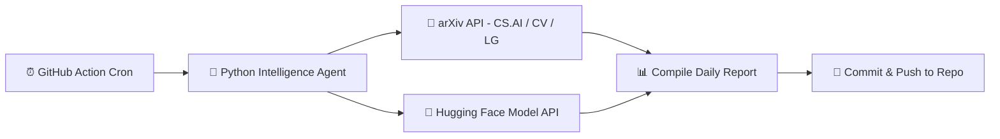

  <h1>⚡ Daily AI Intelligence Hub</h1>
  
<b>Autonomous Daily Engine Tracking Frontier AI Models, Research Papers & Computer Vision Benchmarks</b>

  
  
  

---

### 🛰️ Overview
This repository operates as an **autonomous intelligence agent** maintained by [Krishna Gupta](https://github.com/KrishnaGupta-coder). Every 24 hours at 00:00 UTC, a GitHub Action wakes up, queries the **arXiv AI/ML repository** and **Hugging Face API**, parses latest publications, compiles a structured intelligence report, and commits it directly to the archive.

---

### 📡 Latest Digest Summary (`2026-10-31`)

#### Top arXiv Papers Detected Today:

---

### 📚 Intelligence Archive (Latest 10 Days)

| Date | Report Link | Validation |
| :--- | :--- | :--- |
| 📅 `2026-10-31` | [View Full Intelligence Report](reports/2026-10-31.md) | Verified Automated Digest |
| 📅 `2026-10-30` | [View Full Intelligence Report](reports/2026-10-30.md) | Verified Automated Digest |
| 📅 `2026-10-29` | [View Full Intelligence Report](reports/2026-10-29.md) | Verified Automated Digest |
| 📅 `2026-10-28` | [View Full Intelligence Report](reports/2026-10-28.md) | Verified Automated Digest |
| 📅 `2026-10-27` | [View Full Intelligence Report](reports/2026-10-27.md) | Verified Automated Digest |
| 📅 `2026-10-26` | [View Full Intelligence Report](reports/2026-10-26.md) | Verified Automated Digest |
| 📅 `2026-10-25` | [View Full Intelligence Report](reports/2026-10-25.md) | Verified Automated Digest |
| 📅 `2026-10-24` | [View Full Intelligence Report](reports/2026-10-24.md) | Verified Automated Digest |
| 📅 `2026-10-23` | [View Full Intelligence Report](reports/2026-10-23.md) | Verified Automated Digest |
| 📅 `2026-10-22` | [View Full Intelligence Report](reports/2026-10-22.md) | Verified Automated Digest |

---

### 🛠️ Architecture & Workflow

---

  Autonomous AI Data Pipeline • Designed by <a href="https://github.com/KrishnaGupta-coder">Krishna Gupta</a> • Jaipur, India

