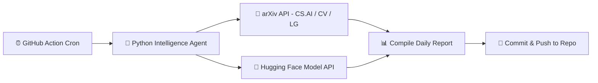

  <h1>⚡ Daily AI Intelligence Hub</h1>
  
<b>Autonomous Daily Engine Tracking Frontier AI Models, Research Papers & Computer Vision Benchmarks</b>

  
  
  

---

### 🛰️ Overview
This repository operates as an **autonomous intelligence agent** maintained by [Krishna Gupta](https://github.com/KrishnaGupta-coder). Every 24 hours at 00:00 UTC, a GitHub Action wakes up, queries the **arXiv AI/ML repository** and **Hugging Face API**, parses latest publications, compiles a structured intelligence report, and commits it directly to the archive.

---

### 📡 Latest Digest Summary (`2026-10-14`)

#### Top arXiv Papers Detected Today:
- **[ChunkAct: Action Chunking for Agentic Robotics](http://arxiv.org/abs/2610.18874v1)** — `2026-10-13`
- **[LoopWAM: Closed-Loop Generalist Policy Improvement from Deployment Rollouts](http://arxiv.org/abs/2610.18873v1)** — `2026-10-13`
- **[EgoExplorer: A Vision-Motion-Touch Observatory for Human Loco-Manipulation In Situ](http://arxiv.org/abs/2610.18872v1)** — `2026-10-13`

---

### 📚 Intelligence Archive (Latest 10 Days)

| Date | Report Link | Validation |
| :--- | :--- | :--- |
| 📅 `2026-10-14` | [View Full Intelligence Report](reports/2026-10-14.md) | Verified Automated Digest |

---

### 🛠️ Architecture & Workflow

---

  Autonomous AI Data Pipeline • Designed by <a href="https://github.com/KrishnaGupta-coder">Krishna Gupta</a> • Jaipur, India

